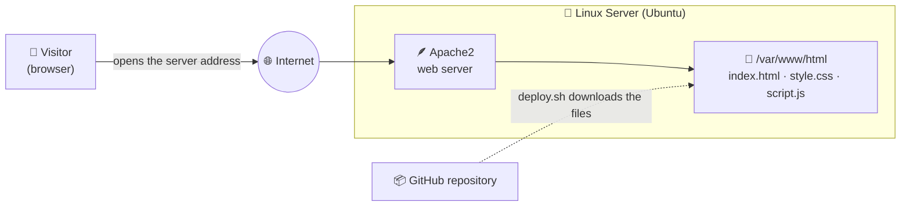
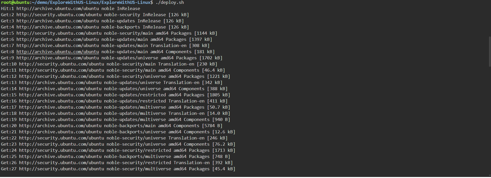
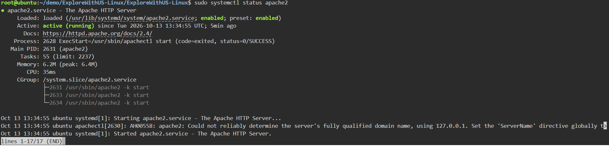
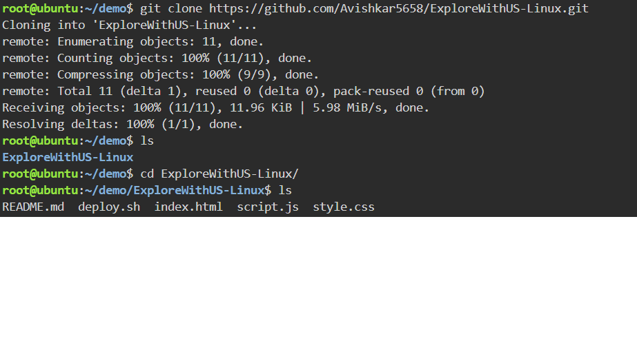

<div align="center">

# 🐧 Host a Website on a Linux Server with One Script

### Turn a blank Linux machine into a live website **automatically**: one command, no manual clicking.


<br>


<sub>👆 <b>Live demo:</b> one command is run in the terminal, and a few seconds later the website opens in the browser.</sub>

</div>

---

## 📑 Table of Contents

1. [The Problem](#-the-problem-in-plain-english)
2. [The Solution](#-the-solution)
3. [Architecture](#-architecture)
4. [Tools Used and Why](#-tools-used-and-why)
5. [What the Script Does](#-what-the-script-does)
6. [Demo and Screenshots](#-demo-and-screenshots)
7. [Step-by-Step Implementation](#-step-by-step-implementation)
8. [Reset and Re-run Demonstration](#-reset-and-re-run-demonstration)
9. [Challenges and What I Learned](#-challenges-and-what-i-learned)
10. [Cost Note and Cleanup](#-cost-note-and-cleanup)
11. [Future Improvements](#-future-improvements)
12. [Use This Project](#-use-this-project-in-your-own-repo)

---

## 🤔 The Problem 

Imagine you built a website about your favourite forts and treks. It works perfectly **on your own laptop**, but nobody else can see it.

To show it to the world, the website must live on a computer that is **switched on 24 hours a day** and connected to the internet. That computer is called a **server**.

**Setting up a server by hand is slow and risky:**

- 😟 Many steps to remember: install software, download files, copy them to the right place, start the service
- 😟 One forgotten step and the website doesn't open
- 😟 Doing it again on a second server means repeating everything from scratch

Real companies set up hundreds of servers. They can't type every step by hand each time.

## 💡 The Solution

This project shows **how to automate it**. I wrote a **Bash script**: a text file of commands that the computer runs one after another, in the right order, every time.

> 🍽️ **Restaurant analogy**
>
> Think of **Apache** as a **waiter**.
>
> - A visitor (the customer) asks for the website.
> - The waiter (Apache) goes to the kitchen (the website folder on the server), picks up the page, and brings it to the visitor.
> - The **script** is the opening checklist: *unlock the door, hire the waiter, stock the kitchen, open for customers.* It is done the same way every morning, without forgetting anything.

| Term | Simple meaning |
|------|----------------|
| 🐧 **Linux** | A free, powerful operating system that runs most of the world's servers |
| 🖥️ **Server** | A computer that stays on and serves websites to visitors |
| 🪶 **Apache2** | Software that listens for visitors and hands them the website |
| 📜 **Bash script** | A file of commands that runs automatically, like a recipe |
| 📦 **Git** | A tool that downloads and tracks project files |

### ✅ Result

**A live website, deployed on a Linux server, with a single command.**

---

## 🏗️ Architecture



**How to read the diagram (follow the arrows):**

1. 👤 A **visitor** types the server's address in a browser.
2. 🌐 The request travels over the **internet** to the Linux server.
3. 🪶 **Apache2**, running on the server, receives the request.
4. 📁 Apache fetches the website files from the folder `/var/www/html`.
5. 📦 Those files were put there earlier by `deploy.sh`, which downloaded them from this GitHub repository.

---

## 🧰 Tools Used and Why

| Tool | What it is (simple) | Why it's used here |
|------|---------------------|--------------------|
| **Ubuntu Linux** | The operating system of the server | A stable, popular choice for hosting |
| **apt** | The "app store" of Ubuntu, used from the terminal | Installs Apache and Git with one command |
| **Apache2** | A web server program | Serves the website to visitors |
| **Git** | A tool to download code from GitHub | Brings the website files onto the server |
| **Bash script** (`deploy.sh`) | A list of commands saved in a file | Automates the whole setup |
| **systemctl** | The service manager of Linux | Starts Apache and keeps it running after a reboot |
| **HTML, CSS, JavaScript** | The website itself | The content visitors see |

---

## ⚙️ What the Script Does

The script runs in **five clear stages**. If any step fails, it stops, so nothing is half-done.

| Stage | What happens | Command used |
|:-----:|--------------|--------------|
| **1. Update** | Refresh the list of available software | `apt update` |
| **2. Install** | Install the web server (Apache2) and Git | `apt install apache2 git` |
| **3. Download** | Fetch the website files from GitHub | `git clone` |
| **4. Publish** | Copy the files into Apache's web folder | `cp ... /var/www/html` |
| **5. Start** | Start Apache and make it start on every reboot | `systemctl enable --now apache2` |

---

## 📸 Demo and Screenshots

> ✏️ *Add your own screenshots to the `screenshots/` folder and keep the file names below, or edit the names here.*

### 🎬 One command, live website

<table>
  <tr>
    <td align="center" width="50%"><b>⌨️ Running the script</b><br><sub>The terminal while <code>deploy.sh</code> runs</sub></td>
    <td align="center" width="50%"><b>🌐 The live website</b><br><sub>Opened in the browser using the server address</sub></td>
  </tr>
  <tr>
    <td></td>
    <td></td>
  </tr>
</table>

### ✅ Apache is healthy and running

The command `systemctl status apache2` shows the web server is **active (running)** ✅

<div align="center">
  
</div>

### 📁 The website files are in the right place

<div align="center">
  
</div>

---

## 🛠️ Step-by-Step Implementation

> 🖥️ **Environment:** any Ubuntu Linux machine (a cloud server, a virtual machine, or a lab playground)

### ✅ Prerequisites

- An **Ubuntu** (or Debian-based) Linux machine
- A user with **`sudo`** permission
- Internet access
- *(If it's a cloud server)* port **80** must be open in the firewall or security group

---

### Step 1️⃣ — Download this project

```bash
git clone https://github.com/Avishkar5658/ExploreWithUS-Linux.git
cd ExploreWithUS-Linux
```

---

### Step 2️⃣ — Look at the script (always read before you run!)

```bash
cat deploy.sh
```

Here is the script, with a plain-English note above every step:

```bash
#!/bin/bash

#Update te apt and install the apache2 server.

sudo apt update
sudo apt install apache2 -y


#To remove the default apache server File.

sudo rm -r /var/www/html/*


#To create the index.html file.

git clone https://github.com/Avishkar5658/ExploreWithUS-Linux.git

cd ExploreWithUS-Linux

#Copy the website to the apache2 default folder.

sudo cp -r ./* /var/www/html


#Restart the apache2 server.

sudo systemctl restart apache2


echo "Websites hosted successfully..."
```

> ✏️ *If your own `deploy.sh` differs (for example it unzips a template), keep your version in the repo and update this block to match it.*

---

### Step 3️⃣ — Run the script

```bash
chmod +x deploy.sh     # allow the file to run as a program
./deploy.sh
```

---

### Step 4️⃣ — Check that Apache is running

```bash
systemctl status apache2
```

You should see **active (running)** in green ✅

---

### Step 5️⃣ — Open the website 🎉

Copy the address printed at the end of the script into your browser. You can also test from the terminal:

```bash
curl -I http://localhost
```

A reply starting with **`HTTP/1.1 200 OK`** means the website is being served.

> ℹ️ **Can't open it from your browser?** On a cloud server, make sure **port 80 (HTTP)** is allowed in the security group or firewall.

---

## ↩️ Reset and Re-run Demonstration

A good script is **safe to run again**. If you change the website and want to publish the update, just run it again:

```bash
./deploy.sh
```

It downloads the latest files and replaces the old ones. No manual cleanup is needed.

> 💬 **Why this matters:** manual setups drift and break over time. A script gives the **same result every time**, which is the foundation of DevOps and automation.

---

## 🎓 Challenges and What I Learned

> ✏️ *Replace the rows below with problems you actually faced. Genuine lessons stand out the most.*

| Challenge | How I solved it |
|-----------|-----------------|
| `Permission denied` when running the script | Gave it permission to run with `chmod +x deploy.sh` |
| Website didn't change after an update | Re-ran the script and refreshed the browser (cleared the cache) |
| Files copied to the wrong folder | Learned that Apache serves from `/var/www/html` and fixed the path |
| Page not opening from outside the server | Opened port **80** in the firewall or security group |

**Key takeaways**

- ✅ How a **web server** delivers a website to visitors
- ✅ Core **Linux commands**: `apt`, `cp`, `systemctl`, `chmod`
- ✅ How to **automate** repeated work with a Bash script
- ✅ Why scripts give **consistent, repeatable** results compared with manual setup

---

## 💰 Cost Note and Cleanup

On a local machine or a free lab playground, this project costs nothing. If you run it on a **cloud server**, check the provider's pricing and stop the server when you are done.

### 🧹 Clean up when you finish

```bash
sudo systemctl stop apache2        # stop the web server
sudo apt remove -y apache2         # uninstall it (optional)
sudo rm -rf /var/www/html/*        # remove the website files
```

If you used a cloud server, also **stop or terminate** the server from the provider's console.

---

## 🔮 Future Improvements

- [ ] 🔐 Add **HTTPS** with a free Let's Encrypt certificate
- [ ] 🌍 Connect a **custom domain name**
- [ ] 🐳 Run the same site in a **Docker** container
- [ ] 🤖 Auto-deploy on every GitHub push using **GitHub Actions** (CI/CD)
- [ ] 🏗️ Provision the server automatically with **Terraform**
- [ ] 📈 Add monitoring and log checks

---

## 🔁 Use This Project in Your Own Repo

Want to try it or add it to your own portfolio?

1. **Fork** this repository (top-right button) or download it as a ZIP
2. Open `deploy.sh` and change `REPO_URL` to **your** repository address
3. Replace the files in `website/` with **your own** website
4. Run it on an Ubuntu machine and take **your own screenshots** for `screenshots/`
5. Write your own **Challenges and What I Learned** section
6. ⭐ If it helped you, give the repo a star!

### 📁 Repository structure

```
ExploreWithUS-Linux/
├── README.md
├── deploy.sh               # the automation script
├── website/
│   ├── index.html          # the web page
│   ├── style.css           # the design
│   └── script.js           # the interactivity
└── screenshots/
    ├── demo.gif
    ├── script-running.png
    ├── website-live.png
    ├── apache-status.png
    └── web-folder.png
```

---

## 👤 Author

**Avishkar Thorave**

[](https://github.com/Avishkar5658)
[](https://www.linkedin.com/in/avishkar-thorve-a77a8b2a1)

---

<div align="center">

⭐ **If you found this useful, give it a star!** ⭐

*Built with 🐧 Linux and a lot of curiosity.*

</div>
